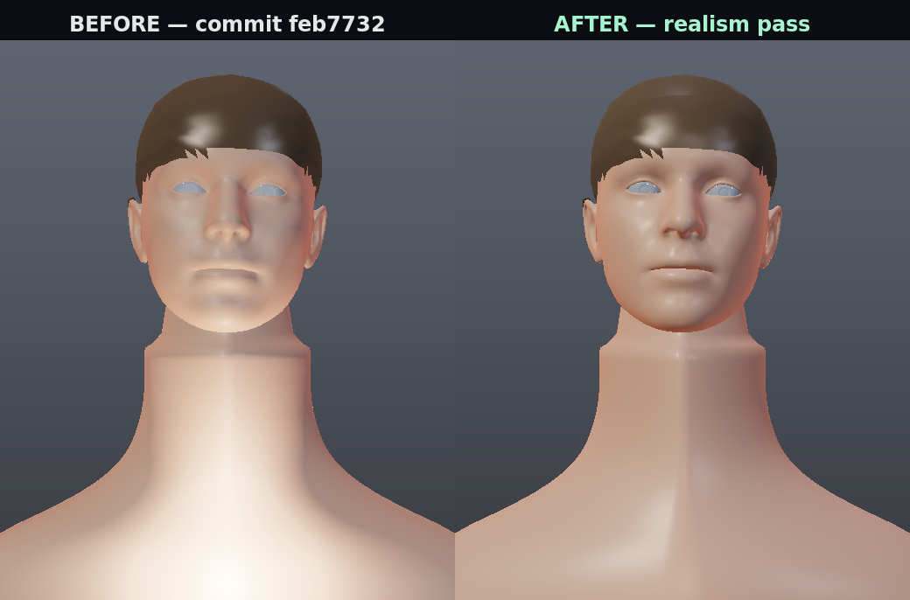

# Faceverify — final report

*Generated 15 October 2026. Branch `arena/9a652a63-faceverify`. Every claim below is marked
with how it was checked; nothing is marked verified that was not.*

---

## 1. Live URL

**There is none.** Deploying needs hosting credentials and neither `vercel` nor `wrangler` is
installed in the build environment, so no deployment was attempted.

Everything needed is in the repository and verified as far as it can be without an account:
`vercel.json`, `public/_redirects` and `public/_headers` are correct and are copied into
`dist/` by the build; the production build passes. Attach a repository to Cloudflare Pages or
Vercel and it deploys — **[docs/DEPLOY.md](DEPLOY.md)** has the exact settings, the pre-deploy
checklist, the post-deploy verification list (which is also the first real browser test this
project will get) and the cost table. Cloudflare Pages is the recommendation: unlimited
bandwidth on the free tier, which matters when a new Live-mode user pulls ~16.8 MiB of
tracker assets.

## 2. What was built

A mobile-first installable PWA that turns a selfie into a rigged ARKit head and animates it
three ways. All face processing happens on the device; nothing is uploaded anywhere; the
tracking model and WASM are self-hosted, so there is no CDN and no API key at runtime.

| Area | What exists |
| --- | --- |
| **Manual mode** | Joystick for yaw (±42°) and pitch (±26°) that springs back to centre, eye panel (hold-to-blink, gaze pad, Split for independent eyes), lips panel (mouth-open slider, smile axis that crosses into a frown, pucker), Reset. |
| **Live mode** | Front camera → head rotation, blinks, gaze, brows, jaw, mouth, smile. One-second neutral calibration with per-blendshape gain, mirror toggle, camera flip, lost-tracking fallback, recording. |
| **Photo mode** | Upload → on-device validation (one face, size, frontal, blur, exposure) → 1024² (512² on lite) face texture projected into the rig's UV space, feathered at the boundary, with the bust tint blended at the jaw. |
| **Recording** | `captureStream()` → `MediaRecorder`, MP4/H.264 preferred with WebM fallback, opt-in microphone, optional watermark, preview, download, Web Share. |
| **Rig** | 52 ARKit blendshapes, separate eye meshes, procedural neck/shoulders, procedural hair shell, teeth. |
| **Tracking** | `@mediapipe/tasks-vision` FaceLandmarker in VIDEO mode, blendshapes + facial transformation matrix, GPU delegate with CPU fallback, One Euro filtering, quaternion (Lie-algebra) smoothing, 640×480 camera, `requestVideoFrameCallback` frame gating. |
| **Rendering** | three.js + react-three-fiber, `MeshPhysicalMaterial` skin with generated albedo/normal/roughness maps, two-layer eyes, ACESFilmic + sRGB, HDR studio environment, contact shadow, in-scene watermark. |
| **Performance** | Three quality tiers, adaptive watchdog around 24 FPS, lite tier that forces the CPU tracker and updates the rig at 30 Hz, DPR capped at 2. |
| **PWA** | Installable, offline shell, 30-entry precache (3.0 MiB), runtime caching for the tracker. |
| **Legal** | `#/privacy`, `#/terms`, upload consent line, "delete my avatar" (storage + IndexedDB + caches). |

## 3. Avatar provider

**`local-fit` — the on-device option, Option B.** Option A (Avaturn) was researched first, as
required, and **not used**, for two reasons: its free tier is the iframe widget only, and the
widget uploads the selfie — which collides with the constraint that nothing is uploaded
unless disclosed. Its API/SDK need the paid PRO plan at **$800/month for up to 1,000 avatars,
then $0.15 each**, and the user must be told before any paid dependency is introduced. Full
write-up, including the terms and the LAM hook, in **[docs/PROVIDERS.md](PROVIDERS.md)**.

| | |
| --- | --- |
| Provider in use | `local-fit` (default, on-device, free, no upload) |
| Also present | `avaturn` — needs `VITE_AVATURN_SUBDOMAIN`; uploads the selfie; discloses first |
| Hook only | `lam` — needs `VITE_LAM_ENDPOINT`; `generate()` throws "not implemented" by design |
| Option C (GPU backend) | **Not built**, as instructed. The interface is the whole hook. |

**Limits of `local-fit`:** it is a texture projection, not a reconstruction. The likeness is
in the face texture; the silhouette, profile and hair come from the base head. Skin tone is
blended at the texture boundary and the jaw seam, but a very different face shape from the
base head will not be matched.

**Licence gap that must be resolved before commercial use:** `public/models/facecap.glb` comes
from the three.js repository, and **no licence grant for commercial use could be found** for
it. It is a file swap to replace, and the swap point is documented.

## 4. Verification status

| Check | Status |
| --- | --- |
| `tsc -b` (strict) | ✅ clean |
| `eslint .` | ✅ 0 errors, 5 `react-refresh` warnings (files that export a hook next to components) |
| `npm test` (node:test) | ✅ 28/28 — filters (11), environment/tier (2), manual mapping (8), recorder format negotiation (7) |
| Production build | ✅ 1.21 s, 0 warnings |
| `[INEFFECTIVE_DYNAMIC_IMPORT]` | ✅ **absent** — see §5 |
| Entry chunk preloads | ✅ 5 chunks + CSS; **the tracker is not among them** |
| Precache | ✅ 30 entries, 3086 KiB |
| Dev server | ✅ binds `0.0.0.0:5173`; every app route and runtime binary returned HTTP 200 |
| Realism before/after | ✅ offline renders from the shipped constants — see §7 |
| Per-frame JS cost | ✅ measured — see §6 |
| **Browser: any of it** | ❌ never run — no browser in this environment |
| **Throttled-CPU FPS** | ❌ not measured — procedure in [docs/PERFORMANCE.md](PERFORMANCE.md) |
| **A recorded video file** | ❌ not produced — see §5 |
| **Camera permission flow** | ❌ not exercised |
| **Deployed URL** | ❌ not deployed |
| **iOS Safari / Chrome Android** | ❌ not tested on hardware |

## 5. Dynamic imports and the recording proof

**Dynamic imports — fixed and verified.** The warning was real: `projectFaceTexture.ts`
imported `HEAD_HEIGHT_METRES` from `loader.ts`, which dragged three.js into the photo-upload
chunk and (as Vite warned) made a static import of a dynamically-imported module. Root cause
fixed by moving the constant to a leaf module, `src/avatar/constants.ts`. The build now emits
no `INEFFECTIVE_DYNAMIC_IMPORT`, and the entry's `modulepreload` list confirms the mediapipe
chunk is separate and not preloaded.

**A real recorded file: not possible here, and not claimed.** Producing one needs a browser
with `MediaRecorder`, a canvas and a codec. What *is* verified about that path:

* The format negotiation is unit-tested (7 cases: no `MediaRecorder`, iOS MP4-only, older
  Android WebM-only, both-supported, codec-string preference, nothing-supported, extension
  mapping). This is the part that fails silently in the wild — a wrong answer produces a file
  that the share sheet refuses, with no error.
* The recorder captures the renderer's own canvas directly. `preserveDrawingBuffer` stays
  `false`, which is deliberate: `captureStream()` is served by the compositor as frames are
  presented and never needs the drawing buffer read back, whereas `preserveDrawingBuffer:
  true` costs a per-frame copy on several mobile GPU drivers.
* The watermark was moved from a 2D compositing surface into the scene (a screen-space quad).
  The old approach blitted the WebGL canvas into a 2D canvas every frame, which is exactly the
  pattern that breaks with `preserveDrawingBuffer: false`. **This is a robustness improvement
  that is argued from the spec, not verified by me in a browser.**

To close it: [docs/DEPLOY.md §4](DEPLOY.md) step 7 — record 15 seconds in Live mode, confirm
the downloaded file plays, has audio when the microphone was opted in, and shows the
watermark.

## 6. Throttled CPU

`node tools/perf-probe.mjs` measures the app's own per-frame JavaScript on the real modules:

| Work | native | ×6 CPU | share of a 24 FPS frame |
| --- | --- | --- | --- |
| `IdleAnimator.update()` | 0.3 µs | 0.002 ms | 0.00% |
| `applyManualExpression()` (52 channels) | 1.2 µs | 0.007 ms | 0.02% |
| live filters (52 channels + quaternion + gaze) | 0.7 µs | 0.004 ms | 0.01% |
| **full JS slice of a live frame** | **1.0 µs** | **0.006 ms** | **0.02%** |

One representative run — these move by about ±20% between runs.

**What this supports:** the animation, filtering and expression-composition layer is not the
bottleneck, and the lite tier's 30 Hz rig update costs nothing measurable.
**What it does not support:** any statement about FPS. Rasterisation, texture upload,
MediaPipe's WASM inference and the compositor are unmeasured — and larger. These are
desktop-CPU numbers; a mid-range Android runs single-threaded JS roughly 3–5× slower.

The device procedure (DevTools → Performance → CPU 6×, record a 20 s live session, read
*Settings → Currently N fps*) with pass criteria and per-device expectations is in
**[docs/PERFORMANCE.md](PERFORMANCE.md)**.

## 7. The realism pass



*Left: commit `feb7732`. Right: after the pass. Software-rasteriser renders of the real
geometry with the real constants — **not browser screenshots**.*

What changed: light ratios (key 2.15 → 2.45, fill 0.85 → 0.62 for a 1:4 portrait ratio, rim
1.45 → 1.7, ambient 0.32 → 0.18, a new hair/back light and a camera-axis catchlight);
material response (skin roughness 0.62 → 0.55, `ior` 1.4, `specularIntensity` 0.6, warmer
sheen, a second subsurface term; eyes split into a slightly rough sclera under a
near-mirror clearcoat at cornea `ior` 1.376); idle life (blink-rate drift, brow follow-through,
tremor).

The probe also found a **latent bug**: the bounce was a point light 0.18 m under the chin with
`decay: 2`, so inverse-square falloff delivered **irradiance 10.6** — more than four times the
key — and washed the neck and chest to white. It is visible as the white wash in the left-hand
image. Fixed by modelling the bounce as what it is (a large, close area source: `decay: 0` with
a cutoff in head-heights), which brings it to **0.42**.

Details, the full tables, and an explicit list of what the render does *not* model (no
textures, no normal maps, no HDR, no shadows) are in **[docs/REALISM.md](REALISM.md)**.

## 8. Phases 1–7

| Phase | Status | Note |
| --- | --- | --- |
| 1 Scaffold + hello-world deploy | **Partial** | Scaffold done and building; **deploy not done** — no credentials |
| 2 Rigged ARKit head + studio + idle | **Done** (code + offline renders) | 52 morph targets confirmed on the real mesh; no browser screenshot exists |
| 3 Manual controls wired | **Done** | 8 unit tests on the mapping; gestures unverified in a browser |
| 4 Photo upload, validation, provider seam | **Done** | Upload consent, validation, projection, provider registry, Avaturn researched, LAM hook left clean |
| 5 Live tracking, filtering, calibration, lost-tracking | **Done** (code) | Never run against a real camera — the highest-risk unverified area |
| 6 Recording, PWA, perf tuning, adaptive quality | **Partial** | PWA and adaptive quality done and built; recording code done, negotiation unit-tested, **no file ever produced** |
| 7 Throttled/low-end testing, README, final deploy | **Partial** | README and docs done, JS cost measured, procedure documented; **device tests and deploy not done** |

## 9. Known limitations

1. **Nothing has run in a browser.** Camera permission, gestures, recording output, iOS quirks
   and frame rate are all unverified. This is the single biggest gap and it is not a coding
   gap — it needs a device.
2. **`facecap.glb`'s licence is unresolved for commercial use.**
3. **Photo mode is a projection, not a reconstruction** — the profile and hair are the base
   head's, not the user's.
4. **One dark studio, no light theme.** The chrome is light-surfaced, but there is no
   `prefers-color-scheme: light` variant; a light system gets the same studio. Deliberate (a
   portrait studio is dark), but it is a gap against "dark and light friendly".
5. **The eyes are shaded rather than solved.** The catchlight comes from a directional light
   and the clearcoat; there is no screen-space reflection or refraction pass, and no
   lid-follows-gaze coupling beyond the squint channels.
6. Back-camera mode has no face-finding assist; the user has to aim.
7. Recording is capped at 90 s; Safari records MP4 only. Blink/smile detection can lag a frame
   at 30 FPS on low-end phones.
8. First Live entry costs ~16.8 MiB (self-hosted MediaPipe). Cached afterwards, but it is a
   real cost on metered data — which is why the tier detector is aggressive about lite.

## 10. Next three upgrades

1. **A licensed base head with real identity geometry.** Today's ceiling is the base head, not
   the lighting. Swapping `public/models/*.glb` for a commercially licensed, higher-fidelity
   ARKit head is a file swap, and the seam code already blends skin tone at the jaw.
2. **LAM-style identity reconstruction** (`src/avatar/providers/lam.ts` is the complete hook):
   a GPU backend running a single-image avatar model, with the disclosure UI already built.
   That is the step from "your face on a head" to "your head".
3. **Device-verified performance tuning.** Now that the JS layer is measured and provably not
   the bottleneck, spend the next pass on the measured part: profile the 6× CPU run on a
   mid-range Android, check whether the MediaPipe CPU delegate survives on the lite tier, and
   tune the tier thresholds against real data instead of estimates.

## 11. Reproducing every number on this page

```bash
npm ci
npm run typecheck && npx eslint . && npm test && npm run build
npm run probe:geometry    # geometry renders  → tools/out/bust-*.png
npm run probe:realism     # before/after renders + the bounce irradiance table
npm run probe:perf        # per-frame JavaScript cost
npm run dev               # then follow docs/PERFORMANCE.md §2 for the FPS figure
```
